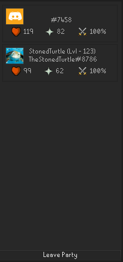
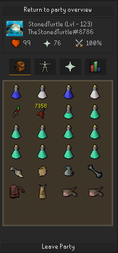
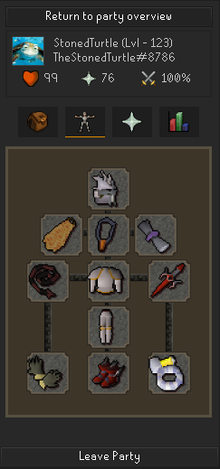
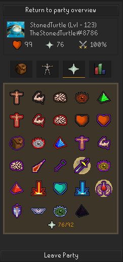
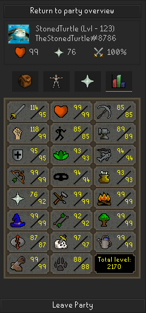

# Party Panel  

Adds a side panel that displays useful information about your discord party members who are also using this plugin, such
as their Inventory, worn Equipment, Active Prayers, and skill levels.

# Using the plugin

This plugin uses the [RuneLite Discord Plugin](https://github.com/runelite/runelite/wiki/Discord) to grab your Discord
Avatar. While not required for this plugin to work,
I recommend enabling the [RuneLite Party Plugin](https://github.com/runelite/runelite/wiki/Party) for its unique
features, such as tile pinging. I would recommend disabling the `Stats` option for
the RuneLite Party Plugin to remove the in-game overlays if you just want to use this party plugin.

The panel marks party members with Zzz after 1 minute of inactivity in the RuneLite game window.
The **Show AFK Indicator** setting is enabled by default and can be turned off. Hover over
Zzz to see minutes of inactivity rounded to the nearest whole minute. Only that AFK duration
is shared with party members, not mouse positions or keys.

The white Zzz icon is bundled with the plugin, so it renders consistently across operating systems.

To learn more about joining a party please read
the [RuneLite Wiki Page](https://github.com/runelite/runelite/wiki/Party#how-to-create-a-party) about this.

# UI Examples

